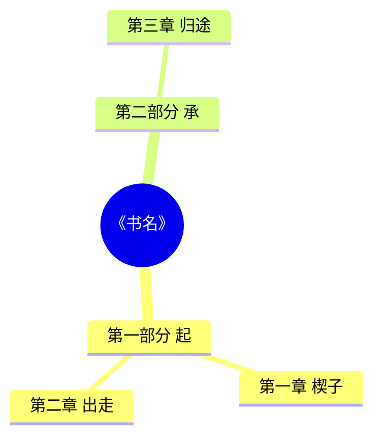

# 27 · 读完之后那张图（0.14.0 设计）

写于 2026-11-21。材料来源：天池两个参赛作品帖，原文摘录在
[`调研-文镜与墨辩两个作品帖.md`](调研-文镜与墨辩两个作品帖.md)。

> **2026-11-21 用户裁定**：「剩下三件事你自行判断，使用你推荐的方式。」
> 三条都按下面「三件事的裁定」执行，不再另议。

---

## 〇之前：三件事的裁定

设计初稿留了三个问题给自己。用户授权自定，下面是我选的和**为什么**，
都是可执行的结论，不是倾向。

### 裁定一：不做情感曲线，做客观节奏曲线

**选：不做情感。**

理由是误差比信号大。中文情感要靠词典，两条路都不通：带词典违反零运行时依赖；
自己抄小词表则在真实文本上会翻车——「他笑着说」被判成正面，「她终于没有哭」被判成负面，
反讽与克制叙述全部判反。

更严重的是**后果不对称**：一条不准的曲线，用户会拿它当结论去写读书报告。
而一条不准的节奏曲线（字数/要点/引文加权）最坏情况只是「这一章的高点标偏了」，
用户看一眼章名就知道对不对。**错得起和错不起，是选哪个的决定因素。**

所以 P1 只算 `score = 0.5×字数 + 0.3×要点数 + 0.2×引文数`，全部来自已有数据，
可复算、可解释、用户能自己核对。

### 裁定二：表态只挂在要点上，不做「不认同作者」

**选：只挂要点。**

「不认同作者」听起来更痛快，但它把产物从「读书笔记」变成「书评」，是另一件事：
书评要交代作者的全部立场、要防止断章取义、要处理「他早期和晚期不一样」。
这些我们在单章范围内给不出证据，而**给不出证据的判断就是偏见**——正好违反整个插件的底线。

要点不一样：它是从**这一章原文**里抽出来的，带引文、能回源。用户对要点表态，
等于对一段他自己能看见的原话表态，证据链是完整的。

如果以后要做书评，那是 `docs/28` 的事，不是把表态按钮换个位置就能到。

### 裁定三：mindmap 下面那份纯文本备份永远写

**选：永远写。**

只在渲染失败时写，需要先知道「渲染会不会失败」。而这个判断要么靠嗅探 Obsidian 版本
（插件读不到，得用户配），要么靠试探（写进去再读回来，成本更高）。

永远写只多十行文件体积，换来三件事：老版本 Obsidian 也能看懂；
图挂了信息不丢；纯文本能被全库搜索命中（Mermaid 代码块里的字搜不到）。
第三条是决定性的——**能被搜到，比好看重要**。

---

## 〇、先说结论

我们现在「读完一本书」能产出的东西，比文镜**深**，但比它**少一张图**。

- 深在：每一句引文都回原文核对过，每一条关系都带出处，产物直接落进你自己的 Obsidian 库。
- 少在：**没有图**。00 全书地图是四段文字加一个章名列表，读完还是要在脑子里自己画。
  主题只有词，没有强度；没有节奏曲线；文论类书（词话、诗话）连章都切不出来。

所以 0.14.0 做四件事，都是「把已经算出来的东西画出来 / 量出来」，不新引入 AI 调用：

| # | 做什么 | 靠什么 | 要不要调 AI |
| --- | --- | --- | --- |
| 1 | 全书地图出一张 **mindmap** | 目录层级（已有 toc） | 不要 |
| 2 | 逐章**节奏曲线** + **主题强度表** | 章节字数、蒸馏要点数、引文数、术语分布 | 不要 |
| 3 | **读法分流**：叙事 / 论述 / 条目 / 文献集 | meta 的分类标签 + 目录形状 | 不要（规则判定） |
| 4 | **一句话表态**（这是墨辩能融进来的那部分） | 蒸馏出的 points 当命题 | 不要 |

四条全部是**确定性**的：同样的书、同样的数据，跑两次结果一样。这一点比图好不好看重要——
图一错，用户就再也不信旁边那些标了出处的文字了。

墨辩的结论放在第六节：**它的社交骨架融不进来，它的核心动作可以**。

---

## 一、文镜做了什么，我们差在哪

### 1.1 它有的

| 它做的 | 我们现在的状态 |
| --- | --- |
| 人物关系图谱（可拖动、悬停看共现次数与对话语气） | 有 Mermaid `graph LR`，落在 02 人物关系.md，由 Obsidian 渲染。**边带原句**，这点它没有 |
| 人物榜、关系明细 | 只有「N 人 · M 条」一行 |
| 主题线，带**强度与覆盖率** | 只有每章的 terms 列表，没有跨章分布 |
| **逐章情感曲线** | 完全没有 |
| 抽取式摘要（抽原句不改写） | 有，而且更强：每句 indexOf 回源核对，核不上标注 |
| 文论模式：按「则」切分，不出人物图 | 没有。txt 只认「第 X 章 / 回 / 卷 / 节 / 篇 / 部」 |
| 文体识别（小说 / 散文 / 文论 / 演示文稿） | 有 `fictionVerdict`，但只用来决定「要不要出人物关系」一件事 |
| 人名三层规则（姓氏窗口 + 分词边界 + 通用词剔除） | 没有。人名全靠 AI 抽 + 原句核对 |

### 1.2 它踩过、并且自己写出来的坑

这段比它的功能更值钱，因为它证明了「纯规则抽人名」真的会错，也证明了错在哪：

- 第一版把「古代」「明月」「余谓」当人名，把「辛弃疾」截成「辛弃」；
- 修法是三层规则：姓氏窗口 + 分词边界校验 + 通用词词频剔除；
- 无姓氏音译名（悉达多、迦摩罗）靠**引语模式**（说 / 道 / 问 / 答 / 曰）识别；
- 别名要合并（小悉达 → 小悉达多），否则一张图裂成两个人演同一个角色。

我们已经有「每条边必须带原句、原句核不上就丢掉」这道闸，比它的规则更硬。
但我们的闸**只能事后拦错**，拦不住**漏抽**——AI 没抽到的人，我们永远不会有。
所以第三条主线是：把人名候选做成一张本地算出来的表，喂给 AI 当已知项，也当自己的降级路径。

### 1.3 它做不到、我们本来就对的

- **原文不上传**：它是浏览器内解析 + 平台存章节文本。我们连上传这一步都没有，书就在你磁盘上；
- **证据可回溯**：它是「标注出处章节，点开回到原文」。我们是**逐字核对**，核不上直接标注「未在原文找到」；
- **账号与云端**：它有账号、有平台数据库。我们没有。

这三条不打算改。

---

## 二、主线一：全书地图出一张图

### 2.1 现在的地图长什么样

`lib/notesync.js` 的 `buildMapInner()`：四段文字（一句话 / 全书主张 / 怎么展开的 / 适合谁读）
加一个「## 分几个阶段」的编号章名列表。

问题很直接：**「分几个阶段」本来是一棵树，我们把它写成了列表。**

### 2.2 改成 mindmap

Obsidian 1.15 起用自家的 Pele 渲染 Mermaid，支持 `mindmap`。已核：Pele 的兼容表写明
「支持 Mermaid 12.1.0 内置的全部图类型」，含 mindmap、xychart、timeline、quadrant、treemap。
用户本机是 `obsidian-1.15.1`，能渲染。

生成规则（**只用目录，不猜**）：



- 根节点 = 书名，用 `(( ))` 圆形；
- 第一层 = 目录的一级项（没有一级目录时，退化成一章一个节点，超过 12 章按 10 章一组分组并标「第 1–10 章」）；
- 第二层 = 二级项。**只到两层**，再深 Obsidian 里会挤成一团；
- 节点文字超过 24 字截断加省略号——Mermaid 的节点不会自动换行，长标题会把图画宽；
- 书名、章名里的 `()[]{}"` 一律去掉（`relations.js` 的 `mermaidSafe` 已经干这个，复用它）。

**放在哪**：00 全书地图.md 里新增一个锚块 `id=map-tree kind=map-tree`，放在原来那段文字下面。
原文字不动 —— 那是给「想读一段话」的人看的，图是给「想看一眼结构」的人看的，两者不冲突。

**渲染不出来怎么办**：Obsidian 旧版或某些主题插件下 mindmap 可能不出图。
图下面紧跟一行纯文本的同样内容（`- 第一部分 / ·· 第一章`），图挂了也不丢信息。
这一行**永远写**，不是 fallback 分支——省得判断版本。

### 2.3 为什么不上自绘的力导向图

侧栏里自己画 SVG 关系图（可拖动、可悬停）是文镜最抓眼的部分，但我们不做，理由三条：

1. **布局引擎是这活儿的全部难点**。力导向要迭代收敛、要防重叠、要在 300px 宽的侧栏里放 40 个节点。
   自己写一个不如 Mermaid 的，用户第一眼就会觉得「比 Obsidian 里那个丑」；
2. **我们的产物边界是「写进你的库」**。图在库里、在你天天打开的 Obsidian 里，比在插件侧栏里更有用——
   侧栏关掉就没了，库里的图明年还在；
3. 侧栏给**文字**更合适：人物榜、关系明细、主题强度，这些是「查」的，不是「看」的。

侧栏只有一处新图：**节奏曲线**（见 3.2）。那是给「这本书哪儿最重」用的，一屏能看完，不需要交互。

---

## 三、主线二：把「量」算出来

新建 `lib/analyze.js`（纯函数，不碰文件、不调模型），产物落到书目录的 `analysis.json`。

### 3.1 数据结构

```json
{
  "version": 1,
  "bookHash": "…",
  "updatedAt": "2026-11-21T…",
  "style": "narrative",
  "styleReason": "分类标签里有「小说」，目录名是「第 X 章」",
  "chapters": [
    { "href": "text/ch1.xhtml", "label": "第一章", "index": 0,
      "chars": 8421, "points": 5, "quotes": 3, "terms": 4, "persons": 6, "score": 0.62 }
  ],
  "topics": [
    { "term": "检视阅读", "chapters": 6, "total": 20, "coverage": 0.3,
      "strength": 0.71, "peak": "第二章", "hits": [{ "href": "…", "label": "第二章", "count": 4 }] }
  ],
  "names": [
    { "name": "贾宝玉", "count": 312, "firstChapter": "第三章", "by": "surname" }
  ]
}
```

### 3.2 节奏曲线怎么算

每章的 `score` 是三个客观量的加权归一，**不含任何情绪判断**：

```
score = 0.5 × 字数占比(归一到全书最大值)
      + 0.3 × 蒸馏要点数占比
      + 0.2 × 引文条数占比
```

它回答的是「这一章作者（和你自己）觉得最重的地方在哪」，不是「这一章悲不悲伤」。

**为什么不做情感曲线**：情感要靠词典。中文情感词典要么带几百 KB 的词表，要么自己抄一份
小词表——后者在小说上会把「他笑着说」判成正、把「她终于没有哭」判成负，误差比信号大。
一个不准的曲线比没有曲线更糟：用户会拿它当结论。所以这一版只画客观节奏。
真要情绪，用蒸馏出来的 points 密度反而更接近「这一章有多少可说的」。

**它长什么样**：蒸馏面板顶部一条 `xychart-beta` 折线（Pele 支持），横轴章序、纵轴 score。
侧栏宽度不够时 Pele 会自动缩，所以坐标轴标签只写章号数字。

### 3.3 主题强度怎么算

输入全部是**已有的蒸馏产物**，不重新扫全文：

1. **候选词**：每章的 `terms[].term` 与 `points[].claim` 里的实词；
2. **抽词**：复用 `threads.js` 的 `gramTerms()`（2–4 字子串 + 虚词表 + 边缘字剔除）。
   不引分词库的理由原文已经写在那个文件里，不重复；
3. **覆盖率** = 出现的章数 / 总章数；
4. **强度** = 该词在全书出现的总次数 ÷ 出现最多的那个词的总次数（0–1）；
5. **门槛**：覆盖率 ≥ 0.1（至少 10% 的章提到）**且** 强度 ≥ 0.15，最多留 20 条。
   门槛宁高：一个词出现在 1 章里不叫主题，叫那一章的词。

**这跟 `threads.js` 的区别**（两者容易被混成一件）：

| | threads.js | analyze 的 topics |
| --- | --- | --- |
| 输入 | 你的「问 AI」记录 | 书的蒸馏产物（术语 + 论点） |
| 范围 | **跨书**：同一件事在 ≥2 本书里都问过 | **单本**：这本书内部讲了几遍 |
| 用途 | 提醒「可以立一页主题」 | 画「这本书的重点分布」 |

### 3.4 人名候选表怎么算（三层规则，抄文镜的坑）

1. **姓氏窗口**：百家姓常见姓 + 2–3 字窗口，取「姓 + 1~2 字」；
2. **分词边界校验**：用 `Intl.Segmenter('zh-CN', { granularity: 'word' })`
   （本机 Node 26 实测能切出「贾宝玉 | 林黛玉 | 便觉得 | 曾在」，见 3.5）；
   候选必须**恰好等于一个分词结果**，否则丢——这一条就是「辛弃疾」不被截成「辛弃」的原因；
3. **通用词词频剔除**：出现在 ≥60% 章节里的候选一定是「我们」「作者」「自己」这类，
   或者一个不是人名的常用词，直接丢；
4. **引语模式补漏**：`(人名)(说|道|问|答|曰|笑道|叹道)` 这个形状里，人名位上的 2–4 字片段
   即使没有姓氏也收——「悉达多」「迦摩罗」是靠这一条进来的。

**用途只有两个，都不直接画图**：

- 喂给 `relations.js` 的 `buildBatchPrompt({ knownPersons })`，提高召回、减少同一人两个节点；
- 在 02 人物关系.md 里写一小节「原文里出现最多的人名（本地统计）」，与 AI 抽的人名对照。
  **不进 Mermaid 图**——图上的边必须有问题，宁缺毋滥。

### 3.5 已验证的前提

- `Intl.Segmenter` 在 Node 26 上能切中文：`贾宝玉 | 初 | 见 | 林黛玉 | 便 | 觉得 | 这个 | 妹妹 | 曾在 | 哪里 | 见过`；
- Pele 支持 `mindmap` 与 `xychart-beta`；
- Obsidian 本机版本 `1.15.1`，走 Pele。

---

## 四、主线三：读法分流

现在 `fictionVerdict()` 只回答一个问题：「要不要出人物关系」。
但一本书该**怎么读**，不止这一件事。改成四类读法，各自决定「地图画什么、笔记写什么、要不要图」。

| 读法 | 怎么判 | 地图 | 笔记 | 人物图 | 主题强度 |
| --- | --- | --- | --- | --- | --- |
| `narrative` 叙事 | 分类/标签命中小说类词，或目录是「第 X 章/回」且有人名 | mindmap + 章 | 按章：要点 / 概念 / 原句 / 我的表态 | 有 | 有 |
| `expository` 论述 | 分类/标签命中非虚构类词，或目录是「第 X 章/节」 | mindmap + 章 | 按章：要点 / 概念 / 方法 / 原句 | 无 | 有 |
| `aphoristic` 条目 | 目录名是「卷 X / 则 X / 第 X 则」，或章的**平均字数 < 800** 且章数 > 20 | 按「卷」分组 | 按则：条目原文 + 关键词，**不分小节** | 无 | 有 |
| `collection` 文献集 | `sourceFormat === 'paper'`（知网造的） | 按主题分组 | 每条题录一块 | 无 | 无 |

判定顺序**从上往下**，命中即停；判不出来落 `expository`（最保守：不做人物图、不加条目分节）。

判定只用**已存在的数据**（meta 的 category/tags、目录标签形状、章节平均字数），
不额外调模型。判错的代价是「这张图不太合适」，不是「数据坏了」。
强制覆盖：`meta.readMode`（用户在书卡右键里能改），优先级最高。

### 4.1 条目型要动的地方在 txt.js

`lib/txt.js` 的 `HEADING_PATTERN` 现在只认「第 X 章/卷/回/节/篇/部/集」与「序言/楔子/…」。
《人间词话》这种是「卷上 / 一 / 二 / …」或「则一」，切出来要么一章要么几十个标题全丢。

改法：加一个**可选的第二套规则**，只在「段落整体很短 + 篇目很多」时启用；
不是把「一」「二」直接塞进主规则——那会把任何以「一」开头的行切成一章。

判据（三条同时）：

1. 全文命中主规则的行数 ≤ 2（说明这本来就不是按章写的书）；
2. 以「^[一二三四五六七八九十百]+$」或「^则[0-9一二三…]+」开头的短行 ≥ 8；
3. 这些短行的平均间距 ≤ 1200 字（条目不会很长）。

命中就按这些短行切；不命中就维持现状（原书按长度硬切）。

---

## 五、主线四：一句话表态（墨辩融进来的部分）

见第六节的判断。设计细节：

### 5.1 动作

蒸馏出的每一条 `points[].claim` 都是一个**命题**——这正好是墨辩的命题句。
界面上每条要点右边加三个小按钮：**认同 / 不认同 / 要修正**，点了弹一个 60–200 字的框。

写完存在书的 `stance.json`：

```json
{ "version": 1, "bookHash": "…", "items": [
  { "id": "…", "chapterHref": "…", "claim": "…", "stance": "disagree",
    "body": "他把「主动」限定在读的人身上，可作者的沉默也是主动的。",
    "createdAt": "…" }
] }
```

### 5.2 落盘

- 01 读书笔记.md 的章块里新增小节「**我的表态**」，每条一行：`> 不认同：…（60–200 字）`；
- 带锚块，用户手改过的照旧不覆盖（沿用现有协议）；
- 跨书总览加一行统计：**表过 N 次态，其中不认同 M 次**。

### 5.3 为什么这是一个按钮而不是一个页面

墨辩是一整个产品：注册、阵营、发言、段位、热榜。我们要的是它那个**动作**——
「读完不肯表态」是读书笔记最常见的死法，笔记抄了一堆，自己一个字没写。
把它挂到已有的要点上，一次点击就能发生；做一个独立页面，用户会先去干别的。

---

## 六、墨辩能不能融：判断

### 6.1 它的骨架融不进来

| 它的机制 | 为什么不行 |
| --- | --- |
| 阵营（正方/反方）+ 支持度此消彼长 | 需要**多人**。我们是单机插件，一个人的投票没有「此消彼长」 |
| 段位、当日热榜 | 需要**服务器**和共享数据。它的实现是纯静态、数据各自在本机——所谓热榜是访客自己的 |
| 命题句由系统发 | 我们的命题应该来自**这本书**，不是每天一句随机句 |

它的技术形态（无后端、localStorage、PBKDF2）本身是个诚实的取舍，但那个取舍的代价它自己写在
「诚实项」里了：每位访客看到独立数据、身份可被本机篡改。对我们来说更没必要——我们连账号都没有。

### 6.2 它的核心动作可以，而且我们本来就缺

它的起点那段话是对的：

> 现在的读书类产品要么把阅读变成打卡，要么把讨论变成点赞数比赛。而真正的文学讨论是
> **有阵营、有代价、有回合**的——你得先选一边，然后为这一边说出一句站得住的话。

我们现在的产物里，**「我现在的判断」这一节是程序故意留空的**
（`lib/threads.js` 的 `buildThreadPage` 写着「判断是你自己的事」，然后留白）。
留白是对的，但只留白等于把这件事交给用户的自觉——而自觉通常不会发生。

所以融的是：**把「留白」变成「一个具体的入口」**。
不用阵营、不用段位、不用热榜，只要「认同 / 不认同 / 要修正」三选一 + 一段话。

### 6.3 「代价」怎么在一个人的场景里成立

墨辩说讨论要有代价——选了阵营就得为它说话。单人场景里的代价是**可统计**：
表过态的条目和没表过的条目比例、认同与不认同的比例、你反对过的作者是不是同一个。

这些数字不给分数、不给段位，只如实写在总览里。**它不激励你，它只是记账。**

### 6.4 顺带一个副作用：画像多一维

`lib/profile.js` 现在的画像是从「问 AI 的问题」算的（问了哪些词、集中在哪章）。
加上表态之后，可以多一个维度：**他对这本书的立场倾向**（认同多还是不认同多）。
这个维度只写进 `profileSentence()`，不参与 prompt 侧重——立场不该影响我们怎么帮他读。

---

## 七、不做清单（这一版）

| 不做 | 理由 |
| --- | --- |
| 侧栏自绘力导向关系图 | 布局引擎是全部难点；图放 Obsidian 里明年还在，侧栏关掉就没了 |
| 情感曲线（情绪正负） | 中文词典误差比信号大；不准的曲线会被当成结论。改做客观节奏曲线 |
| PPTX / PDF 扫描件解析 | 我们已经有五种格式；PPT 不是书 |
| 账号、云端、书源市场 | 边界不变：没有账号、没有服务器、没有遥测 |
| 阵营投票 / 段位 / 热榜 | 需要多人 + 服务器；单人场景没有意义 |
| 自动生成「我的判断」 | 判断必须是他自己写的。程序只提供入口和记录 |
| 引入分词库 / TF-IDF 依赖 | 运行时依赖必须是零。`Intl.Segmenter` 是内建的，够用 |

---

## 八、界面怎么变（尽量少动）

侧栏「读书笔记」面板里，从下往上依次是：

1. **画像**（已有）
2. **我写过什么**（已有）
3. **人物关系**（已有）＋ 新增一行「原文里最多的人名：贾宝玉(312)、林黛玉(288)…」
4. **跨书主题**（已有）
5. **节奏曲线**（新）：一条折线 + 一句「最重的是第 12 章（1.8 万字、7 条要点）」
6. **表态**（新）：`表过 6 次 · 不认同 2 次`，点开是列表，每条能跳到那一章

蒸馏面板里：每条要点右边加三个表态按钮；顶部加一条节奏曲线。

书架卡片：不改。

---

## 九、数据与迁移

- `analysis.json` 是**派生物**，丢了可以重算，不进 git、不备份；
- `stance.json` 是**用户数据**，进备份、跟 qa.jsonl 一个待遇（`lib/store.js` 的备份路径要加一条）；
- `meta.readMode` 是用户可改的设置项，`validateRecord` 里要加枚举校验；
- `distill.json`、`relations.json` 结构不动 —— 这一版不加字段，只加派生物。
  这样老书的旧文件不用迁移。

---

## 十、测试（每一项都能在临时目录里跑）

| 文件 | 钉什么 |
| --- | --- |
| `test/analyze_test.mjs`（新） | 节奏 score 的加权与归一、主题门槛（覆盖率/强度/上限）、人名三层规则各拦掉什么（「古代」「余谓」被剔除，「辛弃疾」不被截断，「悉达多」靠引语进来）、通用词词频剔除 |
| `test/readmode_test.mjs`（新） | 四类读法判定顺序、判不出来落 expository、`meta.readMode` 覆盖优先级、条目型判据三条 |
| `test/mindmap_test.mjs`（新） | 只有两级、超过 12 章分组、节点文字截断、`()[]{}"` 剥离、无目录时的退化形态、纯文本备份行永远存在 |
| `test/stance_test.mjs`（新） | 落盘与读写、60–200 字限制、写进笔记的锚块、用户手改后不覆盖、被引用要点删除后的孤儿处理 |
| `test/txt_test.mjs`（改） | 加条目型切分：词话样本切出 ≥8 条，普通小说样本**不受影响**（关键：新规则不能污染老路径） |
| `test/notesync_test.mjs`（改） | 地图块多一个 mindmap 块、表态小节进章块、纯文本备份行 |
| `test/relations_test.mjs`（改） | `knownPersons` 传人名候选后 prompt 里有那一行 |
| `test/e2e_local_test.mjs`（改） | `analysis.get` / `stance.put` / `stance.list` 三条新路由的接线 |

老测试一条都不许改红：`analysis.json` 不存在时，地图与笔记必须和 0.13.1 完全一样。

---

## 十一、分期

| 期 | 内容 | 依赖 | 大概规模 |
| --- | --- | --- | --- |
| P1 | `lib/analyze.js` + `analysis.json` + 节奏/主题/人名三张表 + 测试 | 无（纯函数） | 新文件约 320 行 + 测试约 200 行 |
| P2 | 地图出 mindmap + 纯文本备份行 + 测试 | P1 的 names（可选） | `notesync.js` 约 60 行 |
| P3 | 读法分流 + `txt.js` 条目型切分 + 测试 | 无 | 新文件约 120 行 + `txt.js` 约 40 行 |
| P4 | 表态：落盘 / 路由 / 界面 / 写进笔记 + 测试 | P1（要点来源已有） | 约 260 行 |
| P5 | 侧栏节奏曲线 + 人物榜文字行 + 文档 | P1–P2 | 约 120 行 |

P1 与 P3 互不依赖，可以并行。P4 必须在 P1 之后（要用 analyze 的章序）。

---

## 十二、和已有一致的地方

- **锚块协议不变**：新增的 mindmap 块、表态小节都是普通块，用户手改过的照旧不覆盖；
- **回源核对不变**：这一版新增的所有文字（主题、人名）都标注来自哪一章，不引入新的「无法核对」内容；
- **零运行时依赖不变**：不引分词库、不引图表库，图交给 Obsidian 的 Pele；
- **AI 调用次数不变**：四条主线一次模型调用都不加。想省额度的用户关掉 AI 也能用 P1/P2/P3。
